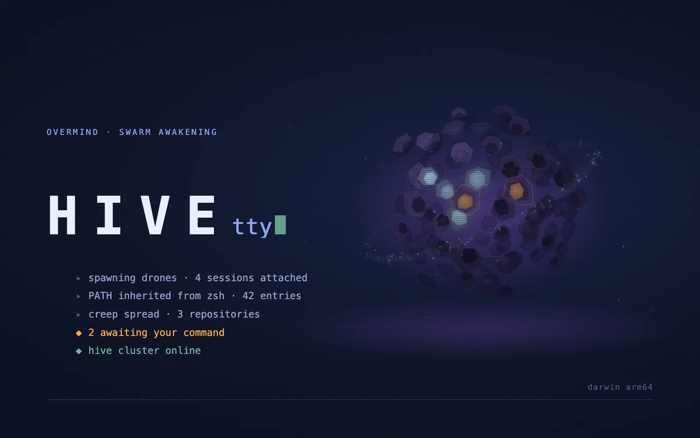
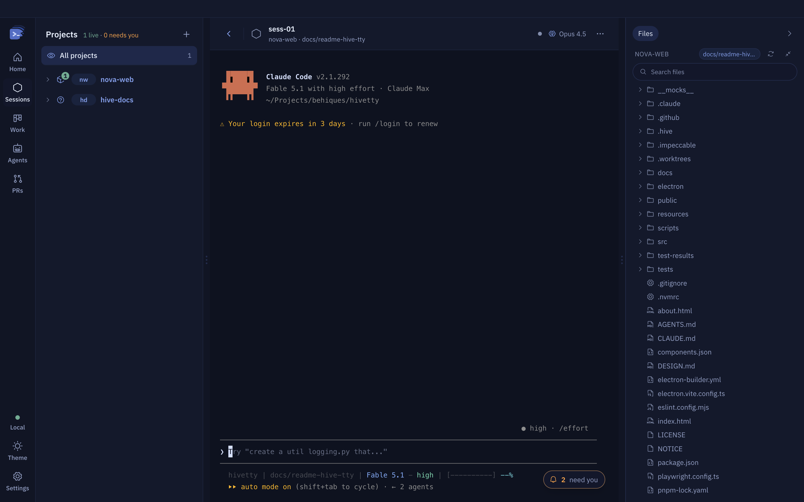

# HiveTTY

**A hive mind for your sessions: many workers, one queen, nothing slipping through the comb.**

HiveTTY is a command center for many Claude Code sessions on one Mac. Every session is a
real `claude` in a real terminal, unchanged: same keys, same output, same conversation.
Around it sits everything you would otherwise leave the terminal for: an inbox that
surfaces the session waiting on you, Jira tickets, pull requests, a file explorer and
editor, custom skills, and background agents.

Built for Claude Code.

## What it does

| Feature | What it does |
| --- | --- |
| **Runs the terminals** | One real PTY per session. Start one from a project, a Jira ticket, or the console: `spawn the-hive "fix the lead form"`. |
| **Notices when one needs you** | Claude Code's hooks report in, so a permission prompt or a finished turn raises an inbox card instead of scrolling past in a tab you were not watching. |
| **Keeps the work in view** | Jira tickets and `gh` pull requests, matched to the session that made them. |
| **Opens the repository** | A project explorer over the active session's checkout, opening files into a CodeMirror editor. |
| **Carries your skills** | Skill folders under `~/.hive/skills` reach every session HiveTTY starts, and no other `claude`. |
| **Runs agents in the background** | Headless `claude` runs that wake on a schedule, a message or a Slack mention, and ask you before they act. |
| **Serves from another Mac** | Run sessions on one always-on Mac and drive them from another over Tailscale. |
| **Follows a theme all the way down** | Chrome, terminal and editor all take their colours from one theme file. |
| **Ends cleanly** | `/done` finishes a session and closes its terminal. The row stays readable, with Resume. |

## Quick start

1. Download the `.dmg` from [the latest release](https://github.com/yunidbauza/hivetty/releases/latest)
   (macOS, Apple silicon). It updates itself.
2. Open it, click **Add a project** on Home, and choose a repository folder.
3. Click **New session**, type the project's name, and press Enter.

That is a live Claude Code session.

## Requirements

| Need | Why | Without it |
| --- | --- | --- |
| **Claude Code** on your `PATH` | every session is a real `claude` | nothing starts. Override per project with `claudeCommand` |
| **git** | the branch each session is on | branches read as a dash |
| **[`gh`](https://cli.github.com)**, signed in | the PRs tab | the PRs tab stays empty |
| **A Jira account** (optional) | the Work tab | the tab says how to connect |

## License

[Apache 2.0](LICENSE) © Yunid Bauza
